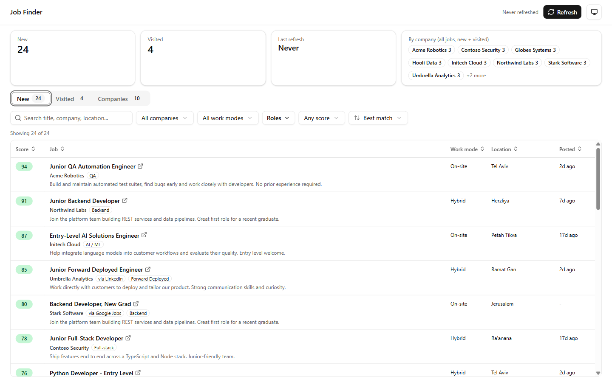
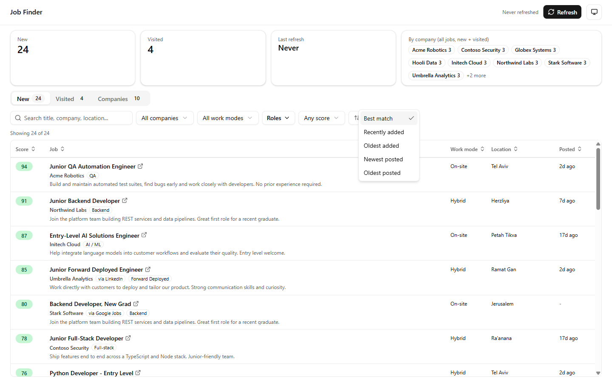
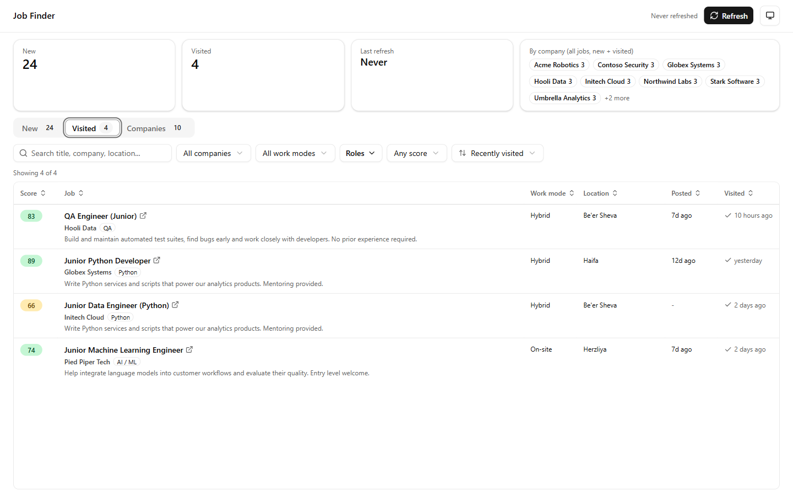
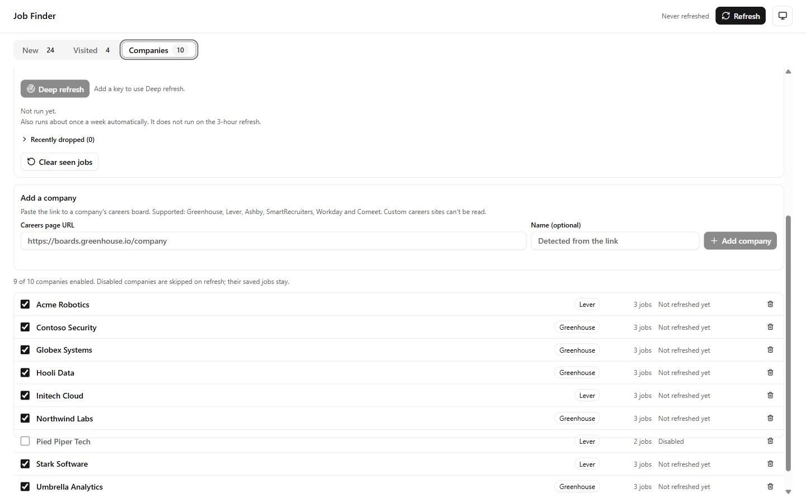
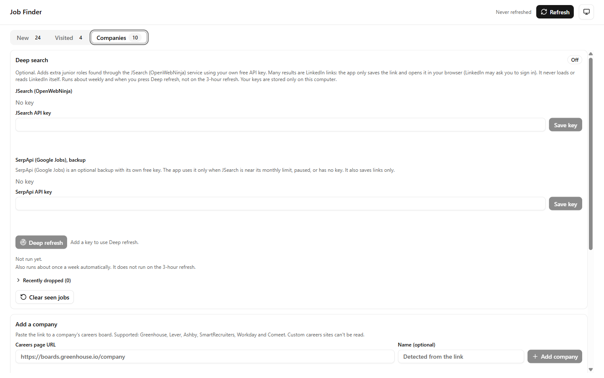

# Job Finder

Personal Electron desktop app that surfaces junior/entry-level/no-experience software roles in Israel (on-site or hybrid; QA, Backend, Python, AI Solutions, Forward Deployed, etc.), with a Visited tab that durably tracks which jobs you've opened.



*The screenshots use made-up demo companies and jobs, not real data.*

## What it does

- **New tab:** jobs scored for junior fit, filterable by company, work mode, role and minimum score, with search. Each row links out to the posting.
- **Sort by:** Best match, Recently added (when the app first saw the job), Oldest added, Newest posted, Oldest posted. Column headers sort too.
- **Visited tab:** a job moves here when you open it and stays there across refreshes and restarts.
- **Companies tab:** the list of career boards the app reads. Paste a careers-page URL to add one.
- **Deep search (optional):** extra roles from JSearch, with SerpApi as a backup. Off until you add your own free-tier key.

| Sort menu | Visited tab |
| --- | --- |
|  |  |

| Companies tab | Deep search panel |
| --- | --- |
|  |  |

## Run it

```bash
npm install
npm run dev     # launches the Electron app with HMR
```

Jobs come from company career pages via public ATS endpoints (Greenhouse, Lever, Comeet, Ashby, SmartRecruiters, Workday, Amazon) plus SQLink (seeded off by default, blocked by Cloudflare). No API keys are needed for these. The app ships with a seeded list of Israeli and multinational employers. Click Refresh, or wait for the automatic refresh every 3 hours while the app is running.

Deep search (JSearch, with SerpApi as fallback) uses your own free-tier keys, which are stored only on your computer. It runs about once a week and when you press Deep refresh, never on the 3-hour refresh. The app only saves links to LinkedIn and similar sites and opens them in your browser. It never fetches them.

Windows installer: `npm run dist` writes it to `release/` (unsigned, so Windows SmartScreen may warn).

## Project docs

See `AGENTS.md` for stack, layout and commands, `RULES.md` for hard constraints, and `PLAN.md` for the roadmap. `docs/session-handoff.md` is the latest status snapshot. This repo uses dedicated Claude Code agents (`.claude/agents/`) for orchestration, frontend, UI/UX, testing, and job-source maintenance.

## Tests

```bash
npm test          # Vitest
npm run test:e2e  # Playwright-Electron (builds first)
```
